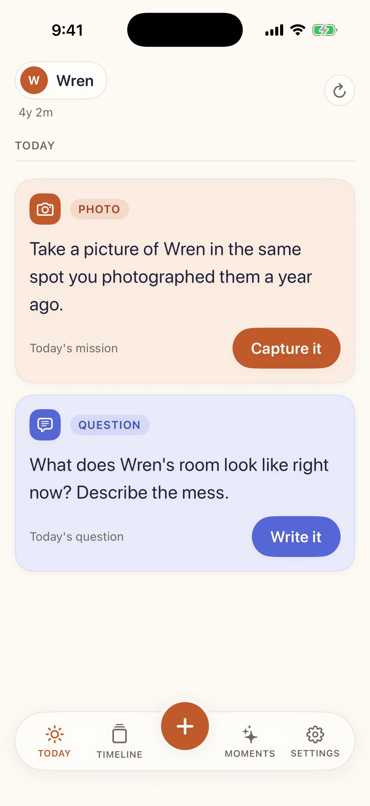
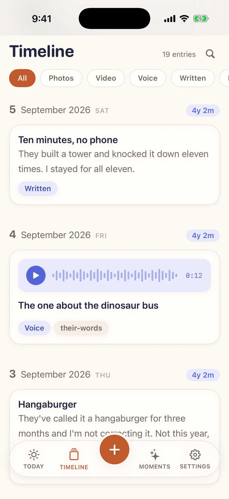
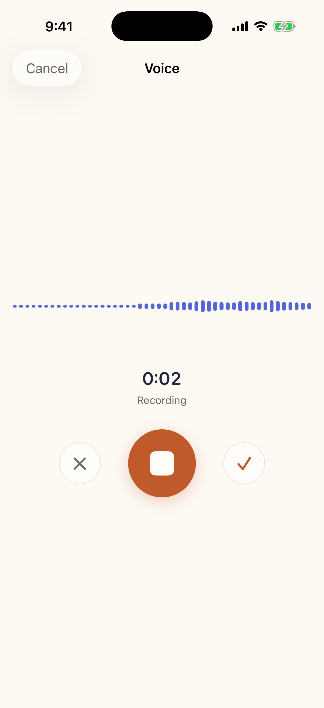
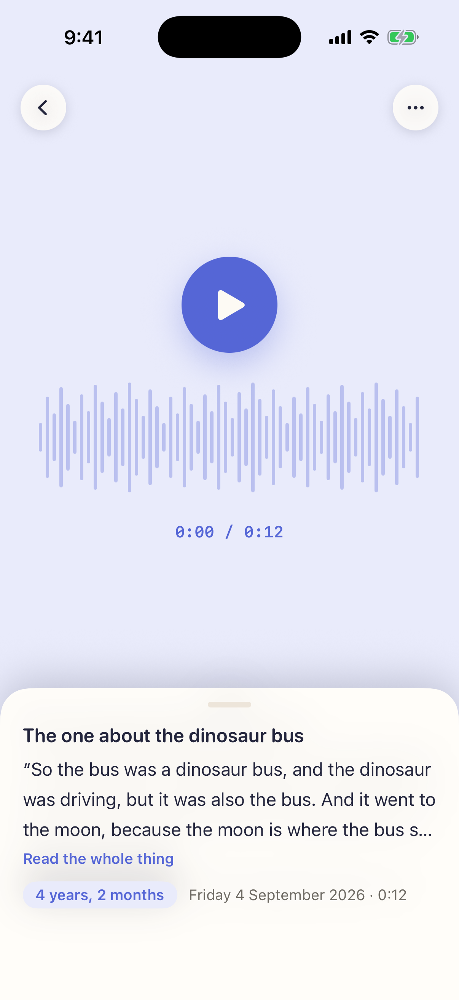
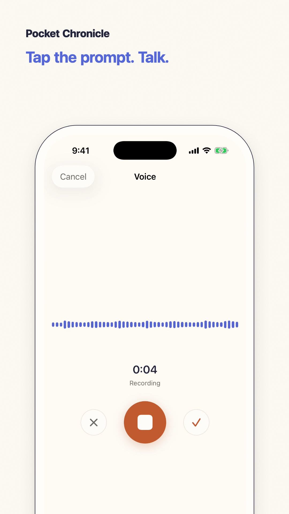
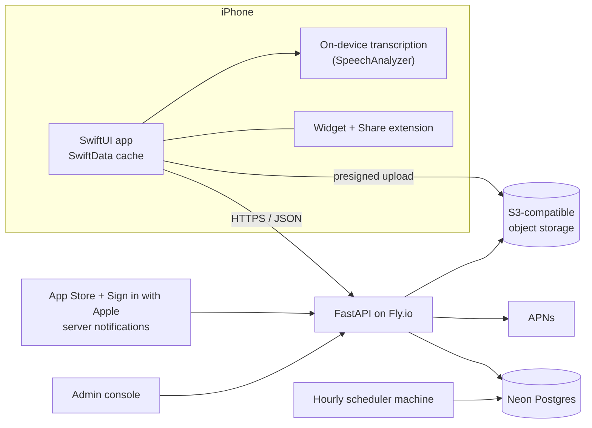

<p align="center">
  
</p>

<h1 align="center">Pocket Chronicle</h1>

<p align="center">
  <b>One question a day. A childhood you can find again.</b><br>
  A private, prompted archive of a child's childhood for iPhone.<br>
  Shipped solo to the App Store in 2026, now retired.
</p>

<p align="center">
  
  <a href="https://github.com/travist6983/Project-Rascal/actions/workflows/ci.yml"></a>
</p>

Every morning the app gives a parent two prompts: **a question** about their kid ("Describe their
laugh.") and **a small mission**: take a photo, film something, record their voice, or just do a
thing together. Each answer is filed with the prompt that caused it, the date it happened and the
child's exact age, on a searchable timeline the kid inherits.

I built it solo, end to end: product, design, the iOS app, the backend, infrastructure, App Store
release and the marketing site. It went from concept to the App Store in about a month, built by
directing AI agents in a stack outside my primary one (Swift). It started as a fix for my own
problem: I forget to take pictures, and when I do, a year later I can't remember why I took them.

**Status:** it worked end to end but did not find users, so I shut it down rather than keep paying to
run the backend. The code stays here as a complete example of a shipped native app and its service.

<table>
  <tr>
    <td align="center"><br><sub>Today's two prompts</sub></td>
    <td align="center"><br><sub>The timeline</sub></td>
    <td align="center"><br><sub>A voice mission</sub></td>
    <td align="center"><br><sub>On-device transcript</sub></td>
  </tr>
</table>

<p align="center">
  <a href="docs/press-kit/video/pocket-chronicle-demo.mp4"></a><br>
  <sub><a href="docs/press-kit/video/pocket-chronicle-demo.mp4">Watch the 30-second demo</a> · screenshots use a fictional demo child</sub>
</p>

## What it does

- **Two prompts a day** from a library of 133, rotated by a server-side scheduler per child and time zone.
- **Four ways to answer:** photo or video, voice, a written note, or "did it" with nothing to upload.
- **Voice is transcribed on the phone** with Apple's `SpeechAnalyzer`. Audio never goes to a
  transcription service, and the words become searchable.
- **Fill in the past.** Backdate any entry, or walk month by month through the photo library to find
  moments worth writing about. Every entry carries the child's age when it *happened*.
- **Search everything**, including what was said out loud. Postgres full-text search over titles,
  bodies, captions and transcripts.
- **Sealed letters** that open at an age you choose, **Moments** that resurface this day in earlier
  years, a Home Screen widget, and a Share extension.
- **Households, not accounts:** several children, a second parent writing into the same archive.
- **One-tap export:** a zip with every entry and file, plus an `index.html` viewer that works offline.

## Engineering highlights

- **Native iOS with zero third-party dependencies.** SwiftUI, SwiftData with offline sync, and
  URLSession only. No analytics, ad or tracking SDKs in the binary. Sign in with Apple, StoreKit 2
  subscriptions, Apple Foundation Models, WidgetKit, a Share extension and push notifications.
- **Async Python backend.** FastAPI, SQLAlchemy 2.0 and Pydantic v2 on Postgres. Routers are thin;
  business logic lives in services that take a session and return objects, with no HTTP in sight.
- **Schema you can trust.** 26 Alembic migrations with named constraints, CHECKs, a functional index
  and triggers. A test runs `upgrade head`, asserts every table, index and trigger by name, then
  runs `downgrade base` and asserts nothing survives.
- **About 2,700 automated tests** across the iOS app and the API. The API's run against a real
  Postgres, not SQLite; S3 is mocked with `moto`, Apple's JWKS with a local keypair, and no test
  touches the network. One acceptance test walks the whole daily loop end to end.
- **Entitlements enforced on the server.** Uploads go straight from the phone to object storage
  through presigned URLs, and the upload endpoint returns `402` unless the household is entitled.
  Reads are never gated: a family that stops paying keeps a readable, searchable, exportable archive.
- **Private by design.** The admin console returns counts, never archive content; no entry body,
  caption, transcript, child name or object key is reachable from an admin route, and a test asserts
  it. Account deletion waits seven days, then hard-deletes.
- **Production operations** while it ran: Fly.io with migrations in the `release_command`, an hourly
  scheduler machine, Neon Postgres, App Store Server Notifications, APNs, and seven GitHub Actions workflows
  (path-scoped API and iOS CI, deploy, smoke tests, backups).
- **Claude in the admin console.** A "Studio" tab drafts social posts and shot lists with Claude,
  and draws on-brand cards locally on a canvas, so images cost nothing and cannot drift off-brand.
- **Built with AI agents, under rules.** The API and iOS code are separate lanes with their own
  `CLAUDE.md` rules, specs in `docs/` are authoritative, and judgment calls are logged in
  `docs/decisions-log.md`. 200 pull requests merged.

## Architecture



| Layer | Stack |
|---|---|
| iOS | Swift, SwiftUI, SwiftData, StoreKit 2, WidgetKit, AuthenticationServices, Speech, Foundation Models |
| API | Python 3.12, FastAPI, SQLAlchemy 2.0 (async), Pydantic v2, Alembic, uv, ruff |
| Data | Postgres 16 (Neon in production), S3-compatible object storage |
| Infra | Fly.io, Docker, GitHub Actions |
| AI | Anthropic Claude (admin Studio), Apple on-device speech recognition and Foundation Models |

## Repository layout

```
api/        FastAPI backend: routers, services, models, migrations, tests
ios/        SwiftUI app, widget, share extension, unit tests (its own CLAUDE.md)
docs/       specs (data model, API contract, decisions), runbooks, press kit
.github/    CI, deploy, smoke, backup workflows
```

## Run it locally

You need [`uv`](https://docs.astral.sh/uv/) and Docker.

```bash
cp .env.example .env    # safe local defaults, no real credentials
make up                 # Postgres 16 on localhost:5433
make migrate            # alembic upgrade head
make seed               # load the prompt library
make test               # the full suite against a real Postgres
make dev                # http://localhost:8000, OpenAPI docs at /docs
```

The full developer guide (dev login without an Apple account, migrations, the mission library, the
admin console, deploying) is in [`docs/DEVELOPING.md`](docs/DEVELOPING.md).

---

Made by [Travis Terry](https://travisjterry.dev) · [LinkedIn](https://www.linkedin.com/in/travisjterry)
